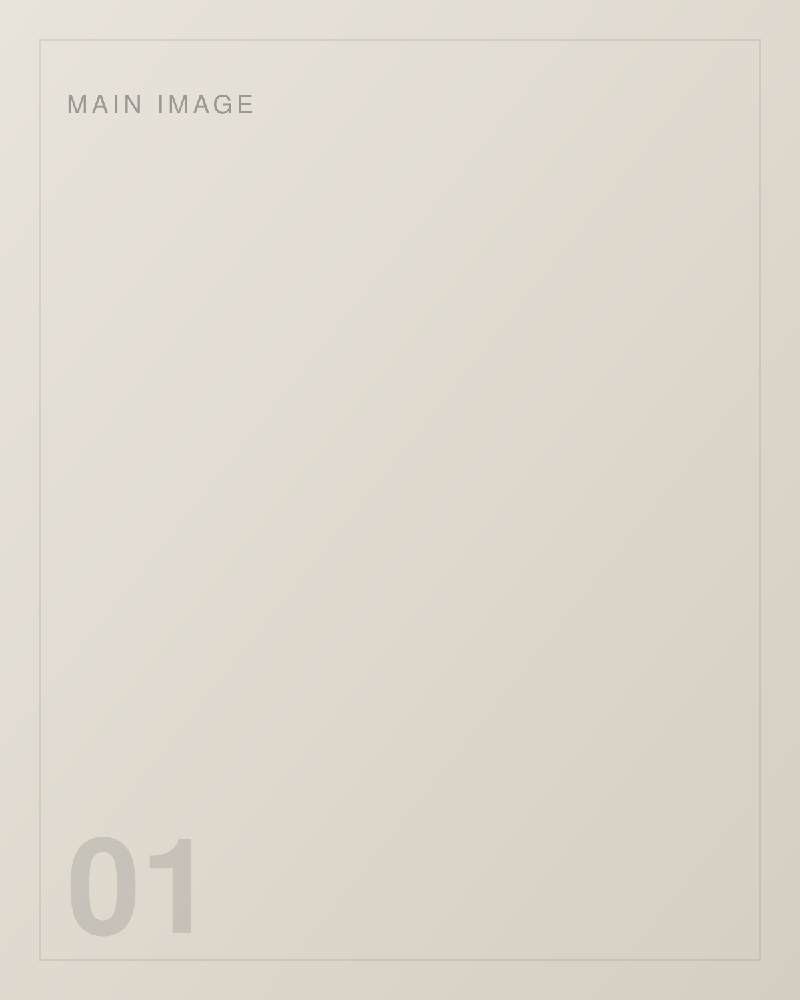

这是一篇用于预览本站功能的原创演示文章。切换深浅色，试着展开折叠内容、切换选项卡、点击图片，看看不同内容在电脑与手机上的表现。

## 文字与层级

一篇作品复盘可以从 **设计目标** 开始，使用 *轻强调* 补充背景，以 ~~旧方案~~ 标记被替换的思路。行内代码示例：`featured_image`。

### 卖点如何转化成视觉

先确定信息顺序，再建立色彩、字体与图片的层级。正文保持舒适的行距，让读者既能快速浏览，也能细读。

#### 第四级标题

适合记录执行细节，不建议让标题层级超过实际内容结构。

> 设计复盘：说清楚为什么这样做，比列出使用过的工具更有价值。

## 提示块

<aside class="demo-note"><strong>信息</strong><p>这里适合补充项目背景、阅读提示和素材说明。</p></aside>
<aside class="demo-note success"><strong>已完成</strong><p>主图、详情页和活动视觉使用同一套字体与配色。</p></aside>
<aside class="demo-note warning"><strong>注意</strong><p>项目图目前为占位素材，正式展示前请替换成真实作品。</p></aside>
<aside class="demo-note danger"><strong>重要</strong><p>不要在公开作品中展示客户未授权的数据。</p></aside>

## 折叠内容

<details class="demo-fold"><summary>展开查看：作品复盘应该写什么？</summary><p>可以按背景、问题、做法、结果四部分组织。说明你负责的范围，配合前后对比图与关键指标。</p><details><summary>补充：没有数据怎么办？</summary><p>可以写用户反馈、信息层级改善和交付规范，避免编造效果数字。</p></details></details>

## 选项卡

<div class="demo-tabs">
<div role="tablist" aria-label="项目阶段"><button id="stage-tab-1" role="tab" aria-selected="true" aria-controls="stage-1">调研</button><button id="stage-tab-2" role="tab" aria-selected="false" aria-controls="stage-2" tabindex="-1">设计</button><button id="stage-tab-3" role="tab" aria-selected="false" aria-controls="stage-3" tabindex="-1">交付</button></div>
<div id="stage-1" role="tabpanel" aria-labelledby="stage-tab-1"><p>明确受众、产品优势和页面目标，整理参考与限制条件。</p></div>
<div id="stage-2" role="tabpanel" aria-labelledby="stage-tab-2" hidden><p>建立视觉方向，完成关键画面，统一组件、字体和留白。</p></div>
<div id="stage-3" role="tabpanel" aria-labelledby="stage-tab-3" hidden><p>检查不同尺寸的阅读效果，输出素材并记录可复用规范。</p></div>
</div>

## 图片与大图预览

点击下方图片打开大图，按 Esc、点击关闭按钮或图片外空白区域退出。



## 列表与表格

1. 明确一个核心卖点。
2. 用图片建立第一眼的识别。
3. 用文字和细节完成说服。

- 主图：强调识别和点击。
- 详情页：强调理解和转化。
- 品牌视觉：强调系统与一致性。

| 内容 | 电脑布局 | 手机布局 |
| --- | --- | --- |
| 作品详情 | 左图右文 | 先文后图 |
| 作品筛选 | 横向排列 | 三列两行 |
| 导航 | 顶部常驻 | 顶部展开层 |

## 代码高亮

```css
.project-card {
  border-radius: 24px;
  background: var(--surface);
  transition: transform 180ms ease;
}
```

## 按钮与链接

<p><a class="hero-link hero-link-primary" href="/work/">浏览作品集 →</a> <a class="hero-link" href="/notes/">查看文章</a></p>

## 动效与支持范围

本站已启用区块进入视口的渐显、卡片轻微抬升、按钮反馈，以及图片大图预览。系统开启“减少动态效果”时会自动减少动画，触屏设备不启用反色鼠标圆形。

提示块、折叠和选项卡使用本站的 HTML 组件。数学公式、Mermaid 图表以及 Redefine 专属标签语法尚未接入，不会把它们列为已支持功能。

参考结构：[Redefine 主题样式演示](https://redefine.ohevan.com/2022/10/02/theme-demo/)。本文内容与组件为本站示例，并非原文转载。

## 音乐播放器

下面是文章内嵌播放器，使用示例网易云歌单。歌单自动加载，不会自动发声。点击文章音乐卡片会调用右下角的同一个全局播放器，不会创建第二个播放器。

<div class="music-inline" data-music-player data-playlist="https://music.163.com/playlist?id=17851162134"></div>

右下角播放器可使用顶部拖动条移动；减号将其隐藏为音乐按钮；歌单加载完成后才显示控件。隐藏不会自动停止音乐，暂停请使用播放按钮。歌单解析依赖外部服务，部分歌曲可能仅能试听或无法播放，请以网易云授权范围为准。

### 单曲播放示例

点击下方卡片播放指定单曲，播放／暂停状态与全局播放器同步。

<div class="music-inline" data-music-player data-playlist="https://music.163.com/song?id=3956911" data-title="播放这首歌曲"></div>
